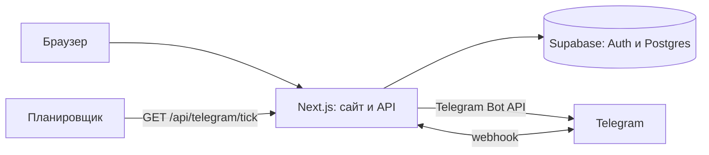

# English Cards

[](https://nextjs.org)
[](https://react.dev)
[](https://www.typescriptlang.org)
[](https://supabase.com)
[](https://core.telegram.org/bots/api)

**English Cards** — личный лексикон и тренажёр английских слов. На сайте можно собирать слова по папкам, повторять их в разных режимах и следить за прогрессом, а Telegram-бот присылает слова по расписанию и помогает повторять их без захода на сайт.

## Возможности сайта

### Библиотека

- **Личный аккаунт** — регистрация, вход и восстановление пароля по email через Supabase Auth.
- **Папки со словами** — карточки с переводом, транскрипцией и примерами предложений.
- **Готовые подборки CEFR** — уровни A0, A1, A2, B1 и B2 создаются в один клик.
- **Избранное** — слова, которые хочется держать под рукой.
- **Частые ошибки** — слова, в которых накопилось две и более ошибки.
- **Выученные** — автоматический архив слов, прошедших нужную серию правильных ответов.
- **Синхронизация копий** — одно и то же слово в разных папках можно связать, и прогресс будет общим.
- **Тёмный минималистичный интерфейс** — с адаптацией под телефон и десктоп.

### Режимы тренировки

| Режим | Что происходит |
| --- | --- |
| **Учить** | Основная сессия по системе интервальных повторений. Новые слова папки идут друг за другом, затем слова на повтор и ошибки. |
| **Заучивание** | Партии по 10 слов и четыре этапа: карточка → выбор перевода → пропуски в слове → написание целиком. |
| **Подбор** | Пары «слово — перевод» на время. Лучший результат сохраняется для каждой папки. |
| **Блоки** | Ввести перевод, а затем собрать ответ из блоков на игровом поле. За точность и скорость начисляются очки. |
| **Диктант** | Слово произносится, его нужно написать на слух. |

### Общая тренировка

- Объединяет все пользовательские папки или только выбранные.
- Убирает дубли слов из разных папок.
- Ведёт отдельный прогресс, не смешивая его с обычными тренировками.
- За одну сессию даёт до 15 новых слов и до 40 слов на повтор, плюс слова из активных ошибок.
- Имеет отдельный экран для работы над общими ошибками.

## Telegram-бот

Бот работает с пользовательскими папками на сайте. Он присылает новые слова, слова с ошибками и те, у которых подошёл срок повтора, чередуя папки между собой.

### Подключение

1. На главной странице сайта найдите блок **«Повторяйте слова в мессенджере»**.
2. Нажмите **«Подключить бота»** — откроется Telegram со ссылкой вида `/start <код>`.
3. Подтвердите запуск. Аккаунт сайта и Telegram-аккаунт будут связаны.

Один аккаунт сайта привязывается только к одному Telegram-аккаунту, и наоборот. При необходимости привязку можно удалить на сайте и подключить другой аккаунт.

### Кнопки под словом

| Кнопка | Действие |
| --- | --- |
| **Знаю** | Засчитывает правильный ответ и планирует следующий повтор. |
| **Не знаю** | Записывает ошибку и запускает частые повторы. |
| **Пропустить** | То же, что не нажать кнопку: слово вернётся позже. |
| **Больше не повторять** | Убирает слово из обычной очереди, но напоминает через 30 и 70 дней. |
| **Удалить из папки** | Удаляет слово с сайта. |

Если слово встречается в нескольких папках, ответ применяется ко всем его копиям.

### Команды

| Команда | Действие |
| --- | --- |
| `/start` | Подключение и приветствие. |
| `/settings` | Окно отправки, частота, часовой пояс, формат перевода, пауза. |
| `/next` | Прислать слово прямо сейчас. |
| `/stats` | Статистика по словам и повторениям. |
| `/time 09:00-21:00` | Задать окно отправки. |
| `/every 1h` | Задать частоту сообщений (от 5 минут до 24 часов). |
| `/pause` | Поставить бота на паузу. |
| `/resume` | Возобновить отправку. |
| `/debug` | Диагностика: последние отправки, очередь и ближайшие повторы. |
| `/help` | Справка по боту. |

### Когда приходят повторы

| Событие | Когда слово вернётся |
| --- | --- |
| **Не знаю** | Через 15 минут, 2 и 5 часов, затем через 1, 2, 4, 7, 15 и 30 дней. |
| **Знаю** | Примерно через 4 дня, затем реже. |
| **Нет ответа или «Пропустить»** | Через 1–2 дня, затем реже. |
| **Больше не повторять** | Через 30 и 70 дней. |
| **Три и более «Не знаю» на сайте** | Слово уходит в обычную очередь повторов бота. |

Все повторы, выпавшие вне окна отправки, переносятся на следующее открытие окна. По умолчанию окно — `09:00–21:00` по `Europe/Moscow`, интервал — 60 минут. Часовой пояс, окно и частоту можно изменить в `/settings`.

## Как работает повторение

### Обычная тренировка

- Слова в папке идут в порядке добавления: сначала новые, затем те, у которых подошёл срок повтора, затем ошибки и остальные.
- Интервалы повторения на сайте: 1, 3, 7, 14, 30, 60, 120 и 240 дней.
- После трёх правильных ответов подряд слово становится выученным.
- **«Не знаю»** возвращает слово в конец текущего круга и сбрасывает его уровень. За сессию слово может вернуться до четырёх раз.
- **«Знаю»** без предыдущих ошибок возвращает слово один раз в конце круга. Если ошибки уже были, ответ завершает слово.
- После трёх ошибок слово убирается из текущей сессии и ставится в обычные запланированные повторы бота. Если Telegram не привязан или слово уже стоит в очереди, тренировка продолжается как обычно.

### Общая тренировка

- Свои интервалы: 1, 2, 3, 5, 7, 12, 15, 20, 25, 27 и 30 дней.
- Ошибка отправляет слово в «Общие ошибки» на два дня.
- Два правильных ответа подряд могут досрочно убрать слово из ошибок.
- Прогресс хранится отдельно от обычных папок.

## Стек

- **Next.js 16** — App Router и серверные API-маршруты.
- **React 19** и **TypeScript** — интерфейс и типизация.
- **Tailwind CSS 4** — оформление.
- **Supabase** — авторизация и PostgreSQL.
- **Telegram Bot API** — webhook, inline-кнопки и отправка сообщений.
- **Web Speech API** — произношение слов в браузере.

## Архитектура



- Сайт работает с Supabase через публичный ключ и RLS-политики.
- Бот и служебные маршруты работают на сервере с `SUPABASE_SERVICE_ROLE_KEY`.
- Telegram присылает обновления на `/api/telegram/webhook`.
- Планировщик раз в минуту вызывает `/api/telegram/tick`, и бот отправляет слова, у которых подошёл срок.

## Быстрый старт

Понадобится Node.js 20 или новее и аккаунт Supabase.

### 1. Клонирование и зависимости

```bash
git clone https://github.com/Shnook0/english-cards.git
cd english-cards
npm install
```

### 2. Переменные окружения

Создайте `.env.local` в корне проекта:

```env
NEXT_PUBLIC_SUPABASE_URL=
NEXT_PUBLIC_SUPABASE_ANON_KEY=
SUPABASE_SERVICE_ROLE_KEY=
NEXT_PUBLIC_SITE_URL=http://localhost:3000

TELEGRAM_BOT_TOKEN=
TELEGRAM_WEBHOOK_SECRET=
TELEGRAM_TICK_SECRET=
TELEGRAM_BOT_USERNAME=
```

| Переменная | Обязательна | Назначение |
| --- | --- | --- |
| `NEXT_PUBLIC_SUPABASE_URL` | Да | Адрес проекта Supabase. |
| `NEXT_PUBLIC_SUPABASE_ANON_KEY` | Да | Публичный ключ Supabase для браузера. |
| `SUPABASE_SERVICE_ROLE_KEY` | Да | Серверный ключ для таблиц бота. Не передавайте его в браузер. |
| `NEXT_PUBLIC_SITE_URL` | Да | Публичный адрес сайта для webhook и ссылок. |
| `TELEGRAM_BOT_TOKEN` | Да | Токен бота от [@BotFather](https://t.me/BotFather). |
| `TELEGRAM_WEBHOOK_SECRET` | Да | Секрет для проверки запросов от Telegram. |
| `TELEGRAM_TICK_SECRET` | Да | Защита маршрутов `/api/telegram/tick` и `/api/telegram/setup`. |
| `TELEGRAM_BOT_USERNAME` | Нет | Username бота без `@`. Если не задан, определяется через `getMe`. |
| `TELEGRAM_OWNER_CHAT_ID` | Нет | Режим одного пользователя: бот слушает только этот `chat_id`. |
| `TELEGRAM_TIMEZONE` | Нет | Часовой пояс по умолчанию. По умолчанию `Europe/Moscow`. |
| `OWNER_USER_ID` или `OWNER_EMAIL` | Нет | Привязка пользователя в режиме `TELEGRAM_OWNER_CHAT_ID`. |

### 3. Supabase

1. Создайте проект в [Supabase](https://supabase.com).
2. Создайте таблицы сайта: `folders`, `cards`, `match_records`, `blocks_records`, `general_trainings`, `general_training_folders`, `general_progress`. Поля описаны в `types/database.ts` и `types/general.ts`.
3. Включите RLS и настройте политики доступа владельца для пользовательских таблиц.
4. Выполните SQL из `supabase/telegram-bot.sql` — он создаст таблицы для бота.
5. В настройках Auth разрешите вход по email, а для восстановления пароля добавьте адреса `http://localhost:3000` и адрес продакшена в список Redirect URLs.

### 4. Запуск

```bash
npm run dev
```

Откройте [http://localhost:3000](http://localhost:3000), зарегистрируйтесь и создайте первую папку.

### 5. Подключение Telegram

Для webhook нужен HTTPS-адрес. Локально можно использовать туннель (например, ngrok или Cloudflare Tunnel).

```bash
npm run telegram:setup -- https://your-domain.com
```

Скрипт установит webhook на `/api/telegram/webhook`. Альтернативный способ:

```text
GET https://your-domain.com/api/telegram/setup?secret=<TELEGRAM_TICK_SECRET>
```

После этого на сайте нажмите **«Подключить бота»** и завершите привязку в Telegram.

### 6. Планировщик

Настройте внешний cron или планировщик, который раз в минуту вызывает:

```text
GET https://your-domain.com/api/telegram/tick?secret=<TELEGRAM_TICK_SECRET>
```

Подойдёт cron-job.org, GitHub Actions, Vercel Cron или другой планировщик с поддержкой HTTP-запросов.

## Скрипты

| Команда | Действие |
| --- | --- |
| `npm run dev` | Запуск dev-сервера Next.js. |
| `npm run build` | Production-сборка. |
| `npm run start` | Запуск production-сборки. |
| `npm run lint` | Проверка ESLint. |
| `npm run telegram:setup -- <url>` | Установка Telegram webhook. |

## Структура проекта

```text
app/                 Страницы сайта и API-маршруты
components/          Интерфейс, тренажёры и Telegram-баннер
lib/                 Supabase, SRS, игровая логика и Telegram-бот
lib/telegram/        Webhook, расписание, настройки и тексты бота
data/cefr.ts         Словари уровней A0–B2
types/               Типы карточек, папок и прогресса
supabase/            SQL для таблиц бота
scripts/             Установка Telegram webhook
public/              Статические файлы
```

## Деплой

1. Разверните проект на Vercel или любом Node.js-хостинге.
2. Добавьте переменные окружения из раздела выше.
3. Укажите продакшен-адрес в `NEXT_PUBLIC_SITE_URL`.
4. Заново установите webhook командой `npm run telegram:setup -- https://your-domain.com`.
5. Настройте вызов `/api/telegram/tick` по расписанию.
